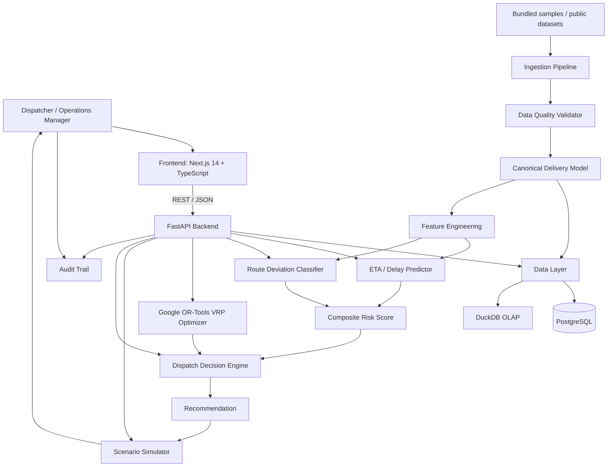

# Pathfinder — AI-Powered Last-Mile Delivery Intelligence

> A last-mile dispatch decision-support prototype: it compares planned vs actual delivery routes, scores route risk, re-sequences stops with Google OR-Tools, and runs what-if scenarios inside a human-in-the-loop dispatcher workflow. It ships with sample data — a real 13-route subset of the Amazon Last Mile dataset and a **synthetic** planned-vs-actual fixture — so its numbers demonstrate the pipeline, not real-world performance.

[](https://www.python.org/)
[](https://fastapi.tiangolo.com/)
[](https://nextjs.org/)
[](https://developers.google.com/optimization)
[](https://github.com/omkark2404/Pathfinder--AI-Powered-Last-Mile-Delivery-Decision-Intelligence/actions)
[](LICENSE)

---

## ⚡ Quick Start (Live Demo)

- 🌐 **Live Dashboard (Frontend)**: [https://pathfinder-ai-powered-last-mile-del.vercel.app](https://pathfinder-ai-powered-last-mile-del.vercel.app)
- ⚙️ **Live Backend API (Swagger)**: [https://pathfinder-ai-powered-last-mile-delivery.onrender.com/docs](https://pathfinder-ai-powered-last-mile-delivery.onrender.com/docs) *(Render free tier spins down after inactivity; the first request can take ~50 s.)*

The dashboard header shows which data the backend has loaded (from `GET /health`).

### Local Setup
Spin up the stack (FastAPI backend + PostgreSQL + Next.js frontend) with Docker:

```bash
git clone https://github.com/omkark2404/Pathfinder--AI-Powered-Last-Mile-Delivery-Decision-Intelligence.git
cd Pathfinder--AI-Powered-Last-Mile-Delivery-Decision-Intelligence
docker-compose up --build
```
* **Frontend Dashboard**: `http://localhost:3000`
* **Backend API Docs**: `http://localhost:8000/docs`

> **Note:** On first start the backend ingests the bundled files in `data/` (see [Section 4](#4-datasets--provenance)). The planned-vs-actual file is a synthetic fixture.

---

## 1. Problem Statement

Last-mile delivery is the most expensive and operationally uncertain segment of logistics. Dispatchers typically face:

- High travel-time variance causing SLA breaches
- Drivers deviating from planned stop sequences without explanation
- No route-level risk visibility before failures compound
- No system connecting prediction → optimization → recommended action in one workflow

Most dispatch tools show telemetry. This system answers: **which route is at risk, why, and what should the dispatcher do about it?**

---

## 2. Core Loop

```
OBSERVE → PREDICT → DIAGNOSE → OPTIMIZE → SIMULATE → DECIDE → AUDIT
```

| Module | What it does |
|---|---|
| **Delivery Risk** | Composite 0–100 route risk score from prototype ETA and deviation models (training status in [Section 6](#6-evaluation)) |
| **Route Intelligence** | Compares planned vs actual stop sequences; computes Kendall Tau similarity |
| **Dispatch Decisions** | Maps each risk band to one rule-based action (MONITOR / RESEQUENCE / REROUTE / ESCALATE) |
| **Route Optimization** | Re-sequences stops with Google OR-Tools to minimize straight-line distance (no time windows yet) |
| **Scenario Simulator** | Compares the planned stop order with solver-based alternatives before committing to a change |

---

## 3. Architecture



### Why ML + OR-Tools (not an LLM)?

- **ML** estimates uncertain outcomes (delay, deviation likelihood) from dispatch-time route features
- **Analytics** measures planned-vs-actual differences where the source data has them
- **OR-Tools** searches for a shorter stop sequence
- **Decision layer** maps the risk score to a rule-based recommendation

The ML models do not generate routes. Stop sequences come from the OR-Tools solver.

---

## 4. Datasets & Provenance

> **DATA MODE**: `GET /health` reports `bundled_samples` with the committed files below, `public_datasets` once both full datasets are in `data/`, and `synthetic_demo` when no files are present (the backend then uses a small in-code fixture labeled `is_synthetic=True`).

### Dataset A — Amazon Last Mile Routing Research Challenge (real subset)

- **Source**: [Registry of Open Data on AWS](https://registry.opendata.aws/amazon-last-mile-challenges/) · Merchán et al. (2022), *Transportation Science*
- **License**: [CC BY-NC 4.0](https://creativecommons.org/licenses/by-nc/4.0/) (non-commercial, attribution required)
- **Committed sample**: `data/amazon_last_mile_sample.json` — 13 routes from 2018, 2,051 stop records (one station per route, used as the depot), package dimensions and planned service times.
- **What the sample does not contain**: the drivers' actual visit order, route distances or durations. These routes are used for optimization only; they have no planned-vs-actual metrics and are not risk-scored or used for training.
- **Full dataset**: 9,184 routes. Place it at `./data/amazon_last_mile.json` (used in preference to the sample). Actual-sequence files are not parsed yet.

### Dataset B — Planned vs Actual Last-Mile Routes (synthetic fixture)

- **Reference dataset**: [Mendeley Data](https://data.mendeley.com/datasets/kkwgfvmtxn), DOI [10.17632/kkwgfvmtxn.1](https://doi.org/10.17632/kkwgfvmtxn.1), CC BY 4.0
- **Committed file**: `data/mendeley_synthetic_fixture.csv` — **synthetic**, 30 routes / 603 stops, generated for this project in the column layout the adapter expects. It is not real delivery data and is ingested with `is_synthetic=True`.
- **Using the real dataset**: download it from the DOI above and place it at `./data/mendeley_planned_vs_actual.csv` (used in preference to the fixture). The adapter's column mapping has only been exercised against the fixture, so check it against the real files first.

---

## 5. Key Technical Components

### ETA / Delay Prediction
- **Model**: `GradientBoostingRegressor` (sklearn), compared with linear-regression and mean-prediction baselines
- **Target**: route-level delay = actual − planned duration (minutes)
- **Features** (9, dispatch-time only): `stop_count`, `planned_distance_km`, `planned_duration_min`, `avg_stop_distance_km`, `avg_stop_duration_min`, `driver_adherence_rate`, `driver_historical_delay_min`, `time_window_pressure`, `route_complexity_score`. With the bundled data the driver and time-window features are constant.
- **Leakage prevention**: `actual_distance_km`, `actual_duration_min`, `actual_arrival` are never used as features
- **Deployed model**: fitted at startup on 5 hand-written rows, so the API reports `insufficient_data`. Offline evaluation is in [Section 6](#6-evaluation).

### Route Deviation Intelligence
- **Model**: `RandomForestClassifier` (sklearn) predicting `is_material_deviation`
- **Target**: distance more than 10% over plan, or Kendall-tau sequence similarity below 0.85 — defined once in `backend/app/analytics/deviation.py` and used by ingestion, the API and evaluation
- **Sequence similarity**: normalized Kendall Tau (concordant/discordant pair counting)
- **Evaluation**: precision, recall, F1 and PR-AUC against a prevalence baseline (`scripts/train_eval.py`)

### Composite Risk Score (0–100)
```
Risk Score =
  (late_probability × 35) +
  (min(1.0, delay_min / 60) × 25) +
  (deviation_probability × 20) +
  (min(1.0, tw_pressure / 50) × 10) +
  (min(1.0, complexity / 50) × 10)
```

| Score | Level |
|---|---|
| 0–20 | LOW |
| 21–50 | MEDIUM |
| 51–75 | HIGH |
| 76–100 | CRITICAL |

`late_probability` is a sigmoid of the predicted delay (not a calibrated probability), so predicted delay drives 60 of the 100 points. Routes without planned distance and duration are not scored.

### Route Optimizer (Google OR-Tools)
- **Formulation**: single-vehicle stop re-sequencing (TSP-style), depot to depot
- **Solver**: OR-Tools routing library (`pywrapcp`), `PATH_CHEAPEST_ARC` first solution, 2-second time limit
- **Distance**: Haversine great-circle distance (integer meters)
- **Objective**: minimize total straight-line distance. Time windows, vehicle capacity and duration limits are not modeled yet.
- **Depot**: the route's station when the data has one, otherwise the first planned stop
- **Baseline**: the planned stop order measured with the same distances, so savings compare like with like. Routes whose source has no dispatch plan (the Amazon sample) get the optimized tour but no baseline or savings.
- **Duration**: estimated by scaling planned duration with the distance saved (flagged `duration_is_estimate`)

### Scenario Simulator
- **RESEQUENCE**: OR-Tools re-sequences the existing stops
- **REMOVE_STOP**: removes the stop given by `removed_stop_id` and re-solves
- **MULTI_VEHICLE**: rough approximation (distance +10%, duration divided by vehicle count)
- **TIME_OPTIMIZED / TIME_WINDOW_PRIORITY**: currently return the same result as RESEQUENCE because the solver has no duration or time-window terms; they are not offered in the UI

---

## 6. Evaluation

**Deployed models.** Both models are fitted at startup on 5 hand-written rows, so `GET /api/v1/metrics` returns `metrics: null` with `evaluation_status: "insufficient_data"`. No real-world model performance is claimed.

**Offline check.** `cd backend && python scripts/train_eval.py` ingests `data/` into a throwaway database, keeps the routes that have outcome data, runs 5-fold cross-validation (seed 42) against baselines, and writes [`docs/eval_results.json`](docs/eval_results.json).

With the bundled files only the 30 **synthetic** fixture routes have outcomes (the Amazon sample has none), so this is a pipeline check on synthetic data, not evidence of accuracy:

| Task | Metric (5-fold CV, mean ± std) | Model | Baselines |
|---|---|---|---|
| Route delay (min) | MAE | Gradient boosting: 30.3 ± 16.9 | Predict the mean: 33.2 ± 4.9 · Linear regression: 35.2 ± 8.1 |
| Material deviation | PR-AUC | Random forest: 0.73 ± 0.06 | Prevalence: 0.37 ± 0.07 |

On 30 routes gradient boosting is not clearly better than predicting the mean. A meaningful evaluation needs real outcome data (the Mendeley dataset, or the full Amazon data with actual sequences) and a split by date or driver.

## 7. Quick Start

### Prerequisites
- Docker & Docker Compose v2

```bash
# Clone the repository
git clone https://github.com/omkark2404/Pathfinder--AI-Powered-Last-Mile-Delivery-Decision-Intelligence.git
cd Pathfinder--AI-Powered-Last-Mile-Delivery-Decision-Intelligence

# Configure environment
cp .env.example .env
# Edit .env and set a strong SECRET_KEY:
# python -c "import secrets; print(secrets.token_hex(32))"

# Build and start all services
docker compose up --build

# Services:
# Frontend:    http://localhost:3000
# Backend API: http://localhost:8000
# API Docs:    http://localhost:8000/docs
# Health:      http://localhost:8000/health
```

### Local development (no Docker)

```bash
# Backend
cd backend
python -m venv .venv
source .venv/bin/activate
pip install -r requirements.txt
DATABASE_URL="" uvicorn app.main:app --reload --port 8000

# Frontend
cd frontend
npm install
npm run dev
```

### Run tests

```bash
cd backend
DATABASE_URL="" pytest -q
# 111 tests (pytest.ini hides third-party DeprecationWarnings from OR-Tools)
```

CI (`.github/workflows/ci.yml`) runs the backend tests and the evaluation script on Python 3.11, and a production build of the frontend.

---

## 8. Reproducibility

| Step | Command / location |
|---|---|
| Data | Files in `data/`; `GET /health` lists which are real, synthetic or missing |
| Evaluation | `cd backend && python scripts/train_eval.py` → `docs/eval_results.json` (includes sklearn version, dataset provenance, folds, seed) |
| Feature contract | `backend/app/ml/features.py` (`FEATURE_NAMES`) |
| Label definition | `backend/app/analytics/deviation.py` (`is_material_deviation`) |

## 9. Project Structure

```text
Pathfinder--AI-Powered-Last-Mile-Delivery-Decision-Intelligence/
├── backend/
│   ├── app/
│   │   ├── api/          # FastAPI REST endpoints
│   │   ├── core/         # Config, database engine
│   │   ├── ingestion/    # Dataset ingestion pipeline & validators
│   │   ├── models/       # SQLAlchemy ORM models
│   │   ├── analytics/    # Operational metrics & route deviation
│   │   ├── ml/           # ETA prediction & deviation classifier
│   │   ├── risk/         # Composite delivery risk scorer
│   │   ├── optimization/ # Google OR-Tools VRP solver
│   │   ├── simulation/   # What-if scenario simulator
│   │   ├── decisions/    # Dispatch decision engine
│   │   └── schemas/      # Pydantic request/response schemas
│   ├── scripts/          # train_eval.py (offline cross-validated evaluation)
│   ├── tests/            # 111 pytest tests
│   ├── Dockerfile
│   └── requirements.txt
├── frontend/
│   ├── src/
│   │   ├── app/          # Next.js 14 App Router pages
│   │   ├── components/   # Sidebar, Header
│   │   └── lib/          # API client (TypeScript)
│   ├── Dockerfile
│   └── package.json
├── docs/
│   ├── ARCHITECTURE.md
│   ├── DATA.md
│   ├── ML.md
│   ├── OPTIMIZATION.md
│   ├── EVALUATION.md
│   └── LIMITATIONS.md
├── data/              # Amazon sample, synthetic Mendeley-schema fixture, full-dataset destination
├── .github/workflows/ # CI
├── docker-compose.yml
├── render.yaml        # One-click Render.com deployment (free tier)
├── .env.example
└── README.md
```

---

## 10. API Reference

| Method | Endpoint | Description |
|---|---|---|
| `GET` | `/health` | Service health and which data files are loaded (real / synthetic / missing) |
| `POST` | `/api/v1/datasets/ingest` | Ingest and validate a dataset (`file_path` must be a file name inside `data/`) |
| `GET` | `/api/v1/datasets` | List all ingested datasets |
| `GET` | `/api/v1/datasets/quality` | Data quality reports for all ingestion runs |
| `GET` | `/api/v1/overview` | Fleet-level KPI analytics |
| `GET` | `/api/v1/routes` | List all routes with performance metrics |
| `GET` | `/api/v1/routes/{id}` | Single route detail with stops and deviation |
| `GET` | `/api/v1/routes/{id}/deviation` | Route sequence deviation analysis |
| `POST` | `/api/v1/routes/predict-risk` | Predict delay and composite risk score for one route (persists a prediction) |
| `GET` | `/api/v1/risk-scores` | Risk scores for all routes (read-only; unscorable routes returned unscored) |
| `POST` | `/api/v1/routes/{id}/optimize` | Run the Google OR-Tools re-sequencing |
| `POST` | `/api/v1/routes/{id}/simulate` | Run what-if scenario simulation |
| `GET` | `/api/v1/recommendations` | List all dispatch recommendations |
| `GET` | `/api/v1/recommendations/{id}` | Single recommendation detail |
| `POST` | `/api/v1/recommendations/decision` | Record dispatcher ACCEPT/REJECT decision |
| `GET` | `/api/v1/drivers` | Driver route counts and a route-difficulty index |
| `GET` | `/api/v1/drivers/{id}` | Single driver detail |
| `GET` | `/api/v1/deliveries` | List deliveries |
| `GET` | `/api/v1/models` | ML model metadata and version info |
| `GET` | `/api/v1/metrics` | Model evaluation metrics (null until real data trained) |
| `GET` | `/api/v1/audit` | Decision audit trail |

---

## 11. Real vs Synthetic Data

| Where | What it tells you |
|---|---|
| `Dataset.is_synthetic` / `GET /api/v1/datasets` | `True` for the Mendeley-schema fixture file and the in-code fallback; `False` for the Amazon sample or downloaded datasets |
| `GET /health` → `data_mode`, `data_sources` | Which files are loaded and whether each is real, synthetic or missing |
| `GET /api/v1/metrics` → `data_mode` | Training data of the deployed models (`synthetic_demo` = the 5 hand-written rows) |
| Dashboard header badge | The `/health` data mode, on every page |

Values the source data does not contain (distances, durations, actual visit order, lateness) are stored as unknown and shown as "n/a" — they are not filled with defaults. Synthetic fixtures support development and tests; they do not establish real-world predictive quality or operational impact.

---

## 12. Privacy & Security

- **No customer PII**: All datasets are public research data with anonymized or transformed location information
- **No production dispatch control**: The system is a decision-intelligence overlay with human-in-the-loop decisions
- **No live company integration**: "Amazon" refers to the public research dataset, not Amazon's production systems
- **No authentication**: write endpoints (ingest, predict-risk, decisions) are open and the audit `user_id` is client-supplied. Run behind an authenticating gateway before exposing it beyond a demo.
- **CORS**: Configurable via `ALLOWED_ORIGINS` environment variable (default `*` is strictly for local development; set explicit frontend domain e.g. `https://your-domain.com` in production)
- **SECRET_KEY**: Must be replaced with a strong random value before any deployment. Generate with:
  `python -c "import secrets; print(secrets.token_hex(32))"`

---

## 13. Known Limitations

| # | Limitation | Detail |
|---|---|---|
| 1 | **Prototype models** | Deployed models are fitted on 5 hand-written rows; the only outcome data bundled is synthetic. See [Section 6](#6-evaluation). |
| 2 | **Amazon sample has no outcomes** | No actual visit order, distances or durations, so those routes cannot be compared, scored or used for training. |
| 3 | **No lateness data** | Neither bundled dataset has arrival timestamps; "stops in planned order" measures sequence adherence, not punctuality. |
| 4 | **Haversine distance model** | The optimizer uses straight-line distance, not road-network distance. OSRM or a distance-matrix API would give realistic travel times. |
| 5 | **Distance-only objective** | No time windows, capacity or duration constraints; duration savings are scaled estimates. |
| 6 | **OR-Tools 2-second time limit** | Enough for tens of stops; the ~190-stop Amazon routes hit the limit, so their tours are the best found, not proven optimal. |

---

## 14. Author & Engineering Notes

Built by **[omkark2404](https://github.com/omkark2404)** — full-stack logistics decision engineering.

* **GitHub**: [@omkark2404](https://github.com/omkark2404)
* **LinkedIn**: [linkedin.com/in/omkar-kumar-2492371b1](https://www.linkedin.com/in/omkar-kumar-2492371b1/)

### Personal Engineering Retrospective
> *"The most interesting part of building Pathfinder was the gap between optimization and operations. OR-Tools will happily produce a shorter stop order, but a dispatcher needs to know why a change is worth making, so I tried to pair each recommendation with its evidence. The biggest lesson was about data: public last-mile datasets rarely contain the outcomes (actual visit order, arrival times) that a delay model needs, and being explicit about what is real, synthetic or missing mattered more than any single model choice."*

---

*Data licenses: Amazon Last Mile Routing Research Challenge dataset — CC BY-NC 4.0 (© Amazon.com, Inc. or its affiliates). Mendeley planned-vs-actual dataset — CC BY 4.0 (not bundled; the committed file is synthetic). Project code — MIT.*
