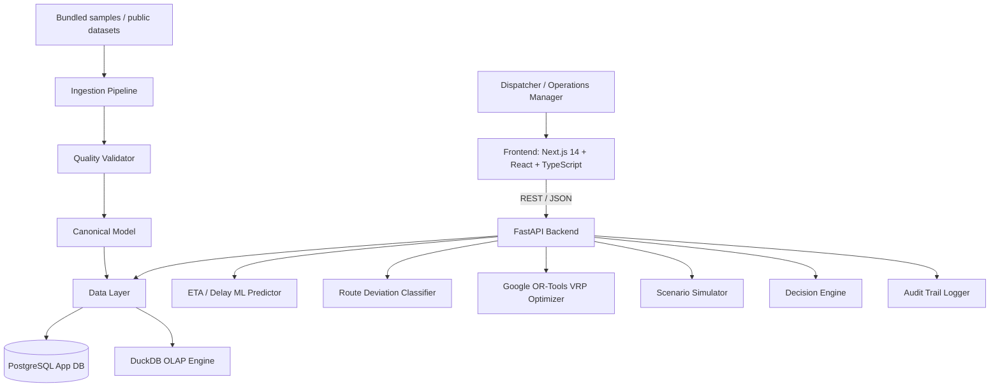

# System Architecture — Pathfinder--AI-Powered-Last-Mile-Delivery-Decision-Intelligence

## Architectural Principles

1. **Modular Monolith**: Simple, clean monorepo architecture avoiding unnecessary microservice overhead.
2. **Optimization + ML Prediction**: ML estimates uncertain outcomes (delay, deviation probability); the OR-Tools routing solver searches for shorter stop sequences within a time limit.
3. **Explicit Data Provenance**: Every dataset is tagged real or synthetic (`is_synthetic`), `GET /health` reports what is loaded, and missing source values stay unknown instead of being filled with defaults.

## Component Flow Diagram

## Layer Breakdown

- **Frontend**: Next.js 14 App Router, TypeScript, Tailwind CSS, Recharts.
- **Backend API**: FastAPI, Async SQLAlchemy ORM, Pydantic V2 schemas.
- **Data Stores**: PostgreSQL 15 (relational application state) + DuckDB (OLAP analytical queries).
- **Optimization**: Google OR-Tools Routing Library (`pywrapcp`).
- **Machine Learning**: scikit-learn, Gradient Boosting Regressor, Random Forest Classifier.
